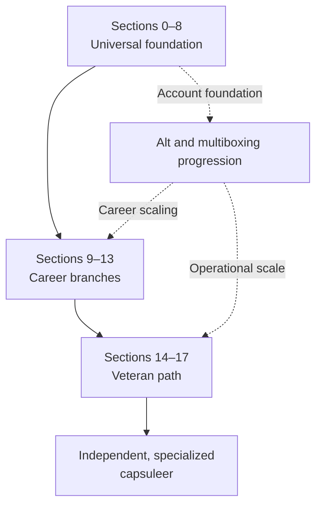

# Ultimate Beginner's Guide to EVE Online — Master Roadmap

> **Roadmap version:** 1.7  
> **Created:** August 18, 2026  
> **Purpose:** Define the guide's teaching sequence, authoring order, scope, and publication standards from first launch to veteran-level independence.

---

## Table of Contents

1. [The Goal](#1-the-goal)
2. [The Core Design: A Spine with Career Branches](#2-the-core-design-a-spine-with-career-branches)
3. [The Complete Content Roadmap](#3-the-complete-content-roadmap)
4. [Detailed Section Specifications](#4-detailed-section-specifications)
5. [What “Accomplished Veteran” Means](#5-what-accomplished-veteran-means)
6. [Recommended Authoring Order](#6-recommended-authoring-order)
7. [Standard Page Template](#7-standard-page-template)
8. [Site and Repository Structure](#8-site-and-repository-structure)
9. [Editorial and Accuracy Standards](#9-editorial-and-accuracy-standards)
10. [Publication Milestones](#10-publication-milestones)
11. [Before You Launch Review and Approved Corrections](#11-before-you-launch-review-and-approved-corrections)
12. [Immediate Next Actions](#12-immediate-next-actions)
13. [Planning Resources](#13-planning-resources)

---

## 1. The Goal

The guide should turn an overwhelmed new capsuleer into an **independent, socially connected, economically sustainable, and strategically aware EVE player**.

It should not attempt to make every reader an expert in every activity. EVE is too broad for that. Instead, it should:

1. Prevent the mistakes that cause new players to quit.
2. Teach universal skills before specialized careers.
3. Let readers sample the major playstyles before committing months of training.
4. Teach players how to replace losses and operate without constant hand-holding.
5. Lead readers into corporations, fleets, dangerous space, and at least one advanced specialty.
6. Eventually teach them how to set their own goals, evaluate new mechanics, and help other players.
7. Deliberately lead readers from single-character fundamentals into effective alt use, multiple Omega accounts, Multiple Character Training, and legal multiboxing so they can scale income, support a corporation, and experience interconnected EVE systems at greater capacity.

The finished guide should function in three ways:

- **Progressive guide:** A first-time player can follow it from Section 0 onward.
- **Reference wiki:** A returning player can jump directly to a mechanic or activity.
- **Decision guide:** A player can compare careers, ships, risks, and progression choices.

---

## 2. The Core Design: A Spine with Career Branches

A completely linear EVE guide eventually becomes dishonest: a miner, solo PvPer, wormholer, market trader, and nullsec fleet pilot do not share one endgame. The solution is a **linear foundation followed by structured branches that rejoin at higher levels**.

### The universal spine

Every reader should complete Sections 0–8. These teach setup, the new-player experience, controls, skills, fitting, survival, money, logistics, corporations, and career selection.

### The career branches

Sections 9–13 are career paths. They should be authored in order, but readers may take them in any order after completing the universal spine. Each career begins with an inexpensive Alpha-friendly entry point and ends with an advanced progression map.

### The veteran path

Sections 14–17 bring the paths back together. They teach living outside highsec, advanced group play, specialization, strategic systems, leadership, and self-directed progression.

### The multiboxing progression

Multiboxing is a guide-wide progression rather than a late optional topic. The opening sections establish one-character competence so the reader can understand each client independently. Section 3 introduces account architecture, alternate characters, Multiple Character Training, and the decision between another character and another Omega account. Later sections apply those concepts to safety, corporation service, mining, Planetary Industry, manufacturing, hauling, scouting, boosting, logistics, and veteran-scale operations.

The guide's editorial position is that single-character play is a valid starting point but an unnecessarily narrow long-term endpoint for readers who want strong corporation utility, scalable industrial income, or access to EVE's full operational depth. It must explain the value of multiboxing candidly while also teaching cost, attention, legal-control, hardware, security, and burnout constraints.

---

## 3. The Complete Content Roadmap

| Section | Working title | Reader milestone | Primary purpose |
|---:|---|---|---|
| 0 | Before You Launch | Informed recruit | Set expectations and create the account correctly |
| 1 | Your First Session | Functional rookie | Complete onboarding without becoming lost |
| 2 | Graduate from Starter Space | New Eden graduate | Use Exordium deliberately and leave prepared |
| 3 | Skills and Character Development | Intentional account planner | Build skill queues and account architecture around future roles |
| 4 | Ships and Fitting Fundamentals | Competent fitter | Understand what a fit is trying to accomplish |
| 5 | Flight, Weapons, and Combat Mechanics | Capable pilot | Control range, apply damage, tank, and disengage |
| 6 | Staying Alive in New Eden | Risk-aware survivor | Navigate danger, avoid traps, and recover from loss |
| 7 | ISK, Markets, Assets, and Logistics | Financially stable operator | Fund characters and accounts, measure net profit, and move assets intelligently |
| 8 | Corporations, Fleets, and Choosing a Career | Connected capsuleer | Find people, choose a direction, and understand high-value multibox roles |
| 9 | PvE Combat Academy | Independent combat pilot | Progress through missions, sites, and group PvE |
| 10 | Exploration Academy | Independent explorer | Scan, hack, travel, and return with loot |
| 11 | Resource Harvesting Academy | Scalable harvesting operator | Progress from one miner to coordinated harvesting fleets |
| 12 | Industry, Trade, and Hauling Academy | New Eden industrialist | Scale PI, production, trade, and logistics across specialized characters |
| 13 | PvP and Faction Warfare Academy | Useful combat pilot | Enter PvP cheaply, contribute, and learn from losses |
| 14 | Living Beyond Highsec | Established resident | Operate and support multi-character logistics in dangerous space |
| 15 | Advanced Ships and Fleet Roles | Specialist pilot | Fly advanced hulls and perform a defined fleet role |
| 16 | Strategic EVE | Senior capsuleer | Understand organizations, sovereignty, structures, and capital warfare |
| 17 | The Veteran Capsuleer | Self-directed veteran | Optimize accounts, specialize, lead, teach, and stay effective as EVE changes |

---

## 4. Detailed Section Specifications

## Section 0: Before You Launch

**Status:** Existing draft; preserve as the foundation.

**Reader outcome:** The reader understands what EVE is, accepts the reality of permanent loss and player conflict, chooses an account state and character identity, and launches with reasonable expectations.

**Major topics:**

1. What EVE Online is—and is not
2. Loss, scams, conflict, and the sandbox
3. Alpha versus Omega
4. Empires, bloodlines, and character appearance
5. Character naming and reputation
6. Account creation, recruitment links, and security
7. Hardware, interface scaling, and accessibility
8. Pre-flight checklist
9. Looking ahead: why the guide develops from one character toward alts and multiboxing

**Section recap:** Account secured, character created, client configured, expectations calibrated.

➡ **Next:** Section 1 — Your First Session

---

## Section 1: Your First Session

**Reader outcome:** The reader can complete the tutorial, control the client, understand the immediate interface, and avoid wasting early rewards.

**Major topics:**

1. The AIR New Player Experience, step by step
2. Camera, Selected Item window, Overview, and radial menu
3. Undocking, approaching, orbiting, keeping at range, warping, docking
4. Locking targets and activating modules
5. Inventory, cargo holds, item locations, and asset safety basics
6. Fitting and repairing the first ship
7. The skill queue: never leave it idle
8. Redeeming items and using unallocated skill points conservatively
9. What happens when the ship or capsule is destroyed
10. First-session mistakes to avoid and a readiness recap
11. Why each client must be understood and controlled independently before multiboxing

**Guided example:** Complete the tutorial, dock safely, place at least 24 hours in the skill queue, and identify the ship, wallet, assets, fitting, and Opportunities interfaces.

**Section recap:** Can undock, move, fight, dock, find owned items, and maintain a skill queue.

➡ **Next:** Section 2 — Graduate from Starter Space

---

## Section 2: Graduate from Starter Space

**Reader outcome:** The reader uses Exordium as a training ground, samples the major careers, and leaves starter space with a plan rather than merely wandering away.

**Major topics:**

1. What Exordium is: safety, restrictions, taxes, and reduced rewards
2. The eight Career Agent sets and how to avoid repeating unnecessary material
3. AIR Career Program: Explorer, Industrialist, Enforcer, and Soldier of Fortune
4. Visions of Greatness Epic Arc
5. Starter-space missions, mining, hacking, and Homefront Operations
6. Titles, achievements, and other onboarding rewards
7. What to keep, sell, reprocess, or insure
8. Selecting an empire destination
9. Using the one-way shipcasters into empire highsec
10. The “ready to leave Exordium” checklist
11. Noting which sampled activities later benefit from specialized characters or simultaneous accounts

**Important teaching point:** Exordium is a classroom, not a permanent income base. The guide should explain why its safety comes with reduced economic opportunity.

**Guided example:** Complete at least one meaningful objective in all four AIR career paths, finish the recommended starter arc, assemble a travel-ready frigate, and relocate intentionally.

**Section recap:** Has sampled all four careers, understands where they are going, and has a basic ship replacement fund.

➡ **Next:** Section 3 — Skills and Character Development

---

## Section 3: Skills and Character Development

**Reader outcome:** The reader can create a skill plan, distinguish ship prerequisites from support skills, and avoid expensive training detours.

**Major topics:**

1. Real-time skill training and skill levels
2. Skillbooks, prerequisites, injected skills, and unallocated SP
3. Certified, personal, and corporation skill plans
4. Attributes, implants, cerebral accelerators, and remaps
5. Alpha restrictions and planning an Omega upgrade
6. Core fitting, navigation, tank, capacitor, targeting, and weapon support skills
7. Why “bigger ship” does not automatically mean “better”
8. Training to a fit instead of merely training to a hull
9. One cumulative, milestone-based skill plan optimized for useful capability at each stopping point
10. Skill injectors, extractors, Expert Systems, and common money traps
11. Characters versus accounts: capabilities, login limits, and terminology
12. Multiple Character Training: what it changes and what it does not
13. Choosing between a same-account alt and another Omega account
14. Role-based account architecture for careers, corporation service, and future multiboxing
15. When to add the first alt or account—and when the reader is not ready
16. Security, launcher organization, naming, and maintaining multiple accounts

**Required deliverables:**

- One cumulative foundation plan with clearly labeled capability milestones
- Copy Entire Plan and Copy This Milestone actions
- Current instructions for importing, naming, saving, and tracking a plan in EVE
- Alpha stopping point, Omega continuation, main-character support branch, specialized-alt shortcut, and multibox extension where their training order materially differs
- “Train this before a cruiser” support-skills checklist
- Character and Account Value Advisor
- Role templates for PI, industry, mining, hauling, boosting, scouting, and corporation support
- MCT-versus-additional-Omega comparison

**Section recap:** Has a purposeful 30-day queue, understands the difference between characters and accounts, and can describe the role and timing of a first alt or additional Omega account.

➡ **Next:** Section 4 — Ships and Fitting Fundamentals

---

## Section 4: Ships and Fitting Fundamentals

**Reader outcome:** The reader can inspect a hull, understand a fitting, simulate changes, and recognize whether a ship has a coherent purpose.

**Major topics:**

1. Hull sizes, technology levels, faction variants, and ship trees
2. Traits, bonuses, role bonuses, and skill scaling
3. High, medium, low, rig, subsystem, and service slots
4. Turret and launcher hardpoints, drone bays, bandwidth, and cargo bays
5. CPU, powergrid, calibration, capacitor, and fitting constraints
6. Active versus passive modules
7. Shield, armor, and hull tanks
8. Buffer, active, passive recharge, and resistance tanking
9. Propulsion, tackle, electronic warfare, utility, and damage modules
10. Rigs, charges, scripts, ammunition, drones, and nanite repair paste
11. Fitting simulation and importing/exporting fits
12. PvE fits versus PvP fits
13. Meta levels, T2 modules, faction modules, and cost discipline
14. The five tests of a coherent fit: purpose, range, tank, capacitor, escape
15. Fitting ships as complementary multibox roles rather than isolated hulls

**Guided example:** Build and simulate a cheap frigate fit, explain every module, and verify that the fit can be afforded twice.

**Section recap:** Can diagnose missing tank, mismatched weapons, range conflict, fitting-resource problems, and poor cost-to-risk decisions.

➡ **Next:** Section 5 — Flight, Weapons, and Combat Mechanics

---

## Section 5: Flight, Weapons, and Combat Mechanics

**Reader outcome:** The reader understands how ships actually move, hit, survive, and escape.

**Major topics:**

1. Grids, distances, vectors, velocity, and align time
2. Approach, orbit, keep at range, and manual piloting
3. Afterburners, microwarpdrives, and propulsion choices
4. Turret optimal range, falloff, tracking, signature, and transversal
5. Missile flight range, explosion radius, explosion velocity, and application
6. Drone control, aggro, range, sizes, damage types, and recall discipline
7. Electronic warfare: webs, scrams, points, jams, dampeners, disruptors, and painters
8. Capacitor warfare and capacitor management
9. Resist profiles, incoming damage, repairs, and overheating
10. Aggression, weapon timers, session changes, and docking/tether restrictions
11. Reading the combat log and post-fight analysis
12. Choosing when to engage, disengage, or sacrifice a ship
13. Attention management, hotkeys, window switching, and independent control of multiple clients

**Guided example:** Use a controlled practice fight or suitable PvE target to test range control, overheating, damage application, and escape.

**Section recap:** Can explain why damage is missing, how tackle works, and whether the ship can leave a fight.

➡ **Next:** Section 6 — Staying Alive in New Eden

---

## Section 6: Staying Alive in New Eden

**Reader outcome:** The reader can recognize danger, navigate hostile space, protect valuable assets, and recover emotionally and financially from loss.

**Major topics:**

1. Starter space, highsec, lowsec, nullsec, wormhole space, and Pochven
2. The Safety setting, Crimewatch, suspect status, criminal status, and CONCORD
3. War eligibility, kill rights, duels, and limited engagements
4. Local chat, directional scanner, probe scanner, and combat probes
5. Bookmarks, safes, tacticals, perches, instant-dock, and instant-undock locations
6. Autopilot, route settings, avoidance lists, and travel fits
7. Gate camps, bubbles, smartbombs, instalockers, and common escape methods
8. Cloaks, the cloak–MWD trick, interdiction nullification, and limitations
9. Scams, contracts, trade windows, hypernet offers, and social engineering
10. Medical clones, jump clones, implants, and pod safety
11. Ship insurance and what it does not cover
12. Lossmail analysis and the replacement loop
13. The golden rule: never fly what you cannot afford to lose
14. Scouts, eyes, pickets, rescue characters, and multibox evacuation planning
15. Legal multiboxing boundaries: independent manual control, no input broadcasting, no bots, and no account sharing

**Guided example:** Create a safe bookmark, use d-scan correctly, inspect a contract, plan a route around danger, and replace a deliberately inexpensive lost ship.

**Section recap:** Can move a modestly valuable ship through highsec and enter lowsec with informed consent to the risk.

➡ **Next:** Section 7 — ISK, Markets, Assets, and Logistics

---

## Section 7: ISK, Markets, Assets, and Logistics

**Reader outcome:** The reader can earn, spend, transport, and protect enough wealth to sustain ordinary play.

**Major topics:**

1. Wallet, journal, transactions, and multiple wallet balances
2. Buy orders, sell orders, spreads, volume, taxes, and broker fees
3. Regional markets and the major trade hubs
4. Contracts: item exchange, courier, auction, collateral, and scams
5. Valuing loot: sell, reprocess, use, or stockpile
6. Assets window, search, containers, staging, and naming conventions
7. Hauling basics, cargo value, courier contracts, and collateral
8. Ship replacement budgets and operating capital
9. Income measured as profit, risk, attention, and enjoyment—not only ISK/hour
10. PLEX, subscriptions, and why new players should not turn the game into a second job
11. Standing, loyalty points, and converting non-ISK rewards
12. Establishing a home base and maintaining travel caches
13. Account economics: Omega, MCT, PLEX, capital, and break-even analysis
14. Incremental profit per account, per active hour, and per attention hour
15. Wallet, asset, contract, and bookkeeping conventions across characters and accounts

**Required deliverables:**

- First 10 million ISK plan
- First 100 million ISK plan
- “Can I Afford to Undock This?” advisor
- Loot disposition decision tree
- Character and Account Value Advisor
- Worked economic examples and links to specialist tools for calculations beyond these two decisions

**Section recap:** Maintains operating capital, can replace primary ships, and understands the true cost and risk of moving assets.

➡ **Next:** Section 8 — Corporations, Fleets, and Choosing a Career

---

## Section 8: Corporations, Fleets, and Choosing a Career

**Reader outcome:** The reader joins EVE's social game safely, participates in a first fleet, and selects one primary and one supporting career.

**Major topics:**

1. NPC corporations, player corporations, alliances, coalitions, and militias
2. Why joining a good corporation accelerates learning
3. Evaluating recruiters, taxes, activity, time zones, services, and expectations
4. Recruitment scams, awoxing risk, background checks, and API/ESI permissions
5. Voice communications, fleet discipline, broadcasts, and fleet history
6. Fleet hierarchy: fleet commander, wing, squad, scouts, logistics, tackle, damage, and support
7. What to bring, how to ask questions, and how not to be a liability
8. Rookie-friendly public communities and fleets
9. Career decision matrix: risk, attention, group dependence, capital, skills, and income
10. Choosing a primary career plus a supporting income or social activity
11. Setting a 90-day personal goal
12. Why corporations value scouts, cynos, boosters, haulers, miners, logistics, and industry alts
13. Planning a primary character, supporting characters, and future multibox fleet roles
14. Corporation services that reduce the cost and complexity of scaling accounts

**Guided example:** Join a legitimate player group or public community and participate in at least one organized fleet or group activity.

**Section recap:** Has people to ask for help, understands basic comms, and has selected a career-school reading path.

➡ **Next:** Choose a Section 9–13 career branches

---

## Section 9: PvE Combat Academy

**Reader outcome:** The reader can select appropriate PvE, fit for the enemy and environment, complete it efficiently, and avoid preventable losses.

**Progression order:**

1. NPC factions, damage types, resist profiles, and triggers
2. Agent missions and standings
3. Combat anomalies, signatures, escalations, and DED-rated sites
4. Ratting and belt threats
5. Abyssal Deadspace fundamentals
6. Homefront Operations and small-group PvE
7. Epic arcs and COSMOS overview
8. Incursions
9. Advanced mission running, burner missions, and marauders
10. Capital PvE and CRAB beacons as an end-stage overview
11. PvE multibox roles: scout, salvager, logistics, links, damage, and escalation support

**Section recap:** Can choose suitable content, research the encounter, fit correctly, control triggers, and price the loss risk.

---

## Section 10: Exploration Academy

**Reader outcome:** The reader can probe signatures, hack sites, travel through unknown space, manage loot risk, and return home.

**Progression order:**

1. Probe scanner, cosmic signatures, and probe formations
2. Scan strength, deviation, probe size, and positioning
3. Data and relic analyzers and the hacking minigame
4. Highsec and lowsec exploration
5. Nullsec exploration and filament travel
6. Wormhole entry, identification, mapping, polarization, and mass awareness
7. Ghost Sites, Sleeper Caches, Covert Research Facilities, and other hazards
8. Combat scanning and locating ships
9. Covert ops frigates, Astero, interceptors, and advanced travel fits
10. Rescue, evasion, loot transport, and extraction planning
11. Exploration support alts: entrance eyes, scouts, probers, rescue, and loot extraction

**Section recap:** Can enter lowsec, nullsec, or wormhole space, run a suitable site, maintain an exit plan, and bring loot home.

---

## Section 11: Resource Harvesting Academy

**Reader outcome:** The reader can harvest ore, ice, and gas with correct ships, compression, fleet support, and risk controls.

**Progression order:**

1. Ore, minerals, reprocessing, and where resources originate
2. Venture mining and first yield calculations
3. Mining barges and exhumer tradeoffs
4. Survey scanners, crystals, residue, cycle control, and waste
5. Ice harvesting
6. Gas huffing in known space and wormholes
7. Moon mining and ore anomalies
8. Mining fleets, boosts, compression, and industrial cores
9. Porpoise, Orca, and Rorqual roles
10. Mining safety, gank economics, intel, and evacuation
11. Reprocessing skills, structures, taxes, and standings
12. Resource pricing and deciding what is worth mining
13. Scaling layouts: one miner; two miners; miners plus booster/compression; miners plus booster, hauler, and scout
14. Yield versus attention, hauling downtime, survivability, hardware limits, and diminishing returns
15. Skill and account templates for miners, booster/compression pilots, haulers, scouts, and reprocessors

**Section recap:** Can select the right hull and crystals, calculate approximate value, use fleet compression, and design a safe multibox harvesting fleet whose additional accounts produce positive incremental value.

---

## Section 12: Industry, Trade, and Hauling Academy

**Reader outcome:** The reader understands margins, facilities, logistics, and opportunity cost well enough to avoid manufacturing at a hidden loss.

**Progression order:**

1. Blueprints, originals, copies, material efficiency, and time efficiency
2. Manufacturing inputs, job installation, facilities, indexes, and taxes
3. Research, copying, invention, reactions, and Tech II production
4. Planetary Industry
5. Basic market trading and order management
6. Regional trading, hauling, and arbitrage
7. Haulers, blockade runners, deep-space transports, and freighters
8. Courier contracts and hauling services
9. Production chains, vertical integration, and spreadsheets
10. Corporation industry, structures, fuel, and access lists
11. Capital and structure production overview
12. Profit accounting, inventory turnover, and opportunity cost
13. PI scaling across characters: colony roles, extraction, factories, hauling, taxes, and maintenance schedules
14. Industry scaling across characters: job slots, research, copying, invention, reactions, production, trade, and logistics
15. Same-account MCT characters versus simultaneous Omega accounts for industrial operations
16. Bottleneck analysis: demand, job capacity, materials, facilities, transport, working capital, and sales velocity
17. Multi-character supply chains, ESI-supported bookkeeping, and permission security

**Section recap:** Can calculate a real margin after all costs, assign specialized characters to an industrial chain, move output safely, and decide whether another character or account will improve net profit.

---

## Section 13: PvP and Faction Warfare Academy

**Reader outcome:** The reader enters PvP with inexpensive ships, understands why fights are won or lost, and contributes meaningfully before having perfect skills.

**Progression order:**

1. PvP mindset, consent to loss, and budgeting multiple hulls
2. Engagement profiles: brawl, kite, scram-kite, snipe, and disengage
3. Tackle, range control, overheating, and capacitor decisions
4. Solo, small gang, fleet, gate camp, and structure-fight differences
5. Faction Warfare enlistment, complexes, frontline systems, and loyalty points
6. Pirate insurgencies and corruption/suppression mechanics
7. Scouting, directional scan, combat probing, and target selection
8. Fleet roles: tackle, damage, logistics, EWAR, links, booshing, and interdiction
9. Bubbles, bombs, command destroyers, and nullsec mechanics
10. Killboards, battle reports, recordings, and loss analysis
11. Doctrine fits, reimbursement programs, and why substitutions matter
12. Finding repeated fights without going broke
13. Multiboxing awareness in PvP: independent inputs, attention limits, complementary roles, and loss exposure

**Section recap:** Has joined real PvP, lost ships constructively, reviewed the losses, and performed at least one defined fleet role.

---

## Section 14: Living Beyond Highsec

**Reader outcome:** The reader can establish and maintain a life in one dangerous region of space.

**Major topics:**

1. Choosing lowsec, sovereign nullsec, NPC nullsec, wormholes, or Pochven
2. Staging systems, jump clones, death clones, and asset distribution
3. Intel channels, standing fleets, response fleets, and local procedures
4. Logistics chains, hauling routes, filaments, wormholes, and jump services
5. Structures, docking rights, tether, vulnerability, reinforcement, and asset safety
6. Sovereignty, Infrastructure Hubs, Skyhooks, ESS, and nullsec economics
7. Wormhole statics, mapping, rolling, home defense, and eviction risk
8. Pochven standings, travel, filaments, and unique rules
9. Local income and replacement planning
10. Evacuation plans and what to do when access disappears
11. Multibox infrastructure: scouts, eyes, cynos where applicable, haulers, bridge support, and staged replacements
12. Redundancy, permissions, authentication, and evacuation across accounts

**Guided example:** Establish a jump clone and deploy a replaceable set of ships in the chosen region without moving every valuable asset there.

**Section recap:** Can operate for a month in the selected space without relying on emergency hand-holding.

➡ **Next:** Section 15 — Advanced Ships and Fleet Roles

---

## Section 15: Advanced Ships and Fleet Roles

**Reader outcome:** The reader trains into advanced ships because a role requires them, not because they merely appear higher on a ship tree.

**Major topics:**

1. Tech II frigates, destroyers, cruisers, battlecruisers, and battleships
2. Tech III destroyers and strategic cruisers
3. Logistics ships and remote repair
4. Command bursts and fleet boosting
5. Interdictors, heavy interdictors, and bubble mechanics
6. Recon ships, black ops, cynos, covert bridges, and hunting
7. Marauders, pirate hulls, and specialized PvE ships
8. Capital ship fundamentals: carriers, force auxiliaries, dreadnoughts, and capitals
9. Supercapitals and titans as strategic assets—not personal progression trophies
10. Skill, implant, fitting, and replacement requirements for each role
11. Advanced multibox combinations: links, logistics, tackle, scouts, cynos, hauling, and capital support

**Section recap:** Has one advanced role, a correct skill plan, appropriate support skills, and a group that actually uses the role.

➡ **Next:** Section 16 — Strategic EVE

---

## Section 16: Strategic EVE

**Reader outcome:** The reader understands how player organizations turn individual ships into economic, political, and military power.

**Major topics:**

1. Corporation and alliance organization
2. Roles, permissions, hangars, wallets, and operational security
3. Fleet composition, doctrine design, and command structure
4. Fleet commanding, scouting, intelligence, and after-action reviews
5. Structures, timers, reinforcement cycles, and campaigns
6. Sovereignty, infrastructure, resources, and strategic objectives
7. Wars, diplomacy, coalitions, espionage, and propaganda
8. Capital escalation, cyno chains, jump fatigue, bridges, and force projection
9. Industry and logistics at alliance scale
10. ESI, third-party tools, authentication, data permissions, and security
11. Corporation leadership, recruitment, retention, and burnout
12. Designing scalable multi-account operations that serve corporation and alliance objectives

**Section recap:** Can explain the strategic purpose of an operation, secure their accounts and permissions, and perform a trusted organizational responsibility.

➡ **Next:** Section 17 — The Veteran Capsuleer

---

## Section 17: The Veteran Capsuleer

**Reader outcome:** The reader no longer needs a prescribed path. They can set goals, evaluate risk, adapt to patches, and make other players more effective.

**Major topics:**

1. Choosing depth versus breadth
2. Building a yearly skill and asset plan
3. Auditing and optimizing an established alt and multiboxing portfolio
4. Creating doctrine-ready hangars and deployment kits
5. Evaluating patch notes, balance changes, and new metas
6. Advanced loss analysis and experimentation
7. Teaching, mentoring, fleet commanding, and content creation
8. Leadership paths: industrial organizer, recruiter, diplomat, FC, director, CEO
9. Avoiding burnout and maintaining healthy goals
10. Returning after a break
11. Defining your own endgame
12. Consolidating, transferring, pausing, or retiring characters and accounts without breaking the operation

**Veteran application:** Plan and complete a personally meaningful EVE project—lead a fleet, establish a multi-character industrial chain, operate a coordinated mining fleet, live in a wormhole, complete an advanced PvE objective, run a market operation, contribute to a campaign, or mentor a new capsuleer.

---

## 5. What “Accomplished Veteran” Means

The guide should use capability milestones rather than skill points, wallet balance, or ship size.

| Level | A player at this level can… |
|---|---|
| Rookie | Operate the UI, finish onboarding, maintain a queue, and replace a cheap ship |
| Developing capsuleer | Fit and fly T1 frigates/destroyers coherently, use d-scan, manage ISK, and ask informed questions |
| Independent capsuleer | Fund a chosen activity, travel safely, fly in fleets, recover from ordinary losses, and identify a useful first alt role |
| Established specialist | Perform one career at an advanced level, operate complementary characters or accounts, and live in at least one dangerous region |
| Accomplished veteran | Adapt without a step-by-step guide, optimize a sustainable multi-character operation, perform trusted group roles, analyze failures, and help others succeed |

Owning a capital ship, having 100 million skill points, or accumulating a large wallet does not by itself make someone accomplished.

---

## 6. Recommended Authoring Order

Write the guide in the same order as the roadmap. Do not start with favorite advanced subjects; they depend on vocabulary and mental models introduced earlier.

### Workstream 1: Build the foundation

1. Approve this master roadmap.
2. Use the production handbook as the style and source authority, the site product specification as the publishing and technical authority, and the glossary and reusable page template as separate governing sources.
3. Establish the Astro/Starlight product foundation, machine-readable page schema, navigation, Pagefind search prototype, preview builds, and site-level quality checks defined by `site-product-specification.md`.
4. Migrate Section 0 into the product foundation without changing its factual content merely for technical conversion.
5. Write Sections 1–2, using a genuinely new character for optional usability walkthroughs when practical.
6. Write Sections 3–8, introducing the account-planning and multiboxing foundation in Section 3 and carrying it through economy, safety, corporations, and career choice.

### Workstream 2: Build the career branches

7. Write Section 9: PvE.
8. Write Section 10: Exploration.
9. Write Section 11: Resource harvesting.
10. Write Section 12: Industry, trade, and hauling.
11. Write Section 13: PvP and Faction Warfare.
12. Add a career comparison page that links into all five academies.
13. Add the multiboxing progression for each career, including role combinations, skill plans, cost models, attention limits, and required visuals.

### Workstream 3: Build the veteran path

14. Write Section 14: Living beyond highsec.
15. Write Section 15: Advanced ships and roles.
16. Write Section 16: Strategic EVE.
17. Write Section 17: The veteran capsuleer.

### Workstream 4: Harden the wiki

18. Add appendices, reference tables, the two approved decision advisors, and indexes, including the alt and multiboxing reference hub.
19. Conduct terminology, multiboxing-progression, search, accessibility, and link audits.
20. Gather usability feedback from Alpha readers, single-account Omega readers, same-account MCT characters, multiple Omega accounts, and international readers when available.
21. Complete the ultimate-release checks in `site-product-specification.md`, publish, gather corrections, and begin the maintenance cycle.

---

## 7. Standard Page Template

`page-template.md` is the single canonical reusable page template. It defines required metadata, the normal teaching sequence, optional elements, callouts, and the completion checklist. The production handbook defines the editorial rules behind the template.

Use the template as a consistent framework rather than forcing empty headings onto every page. Omit optional elements that do not materially help the reader, and record any substantial structural departure in the section blueprint.

The canonical callout vocabulary and page-completion questions are maintained only in `page-template.md`.

---

## 8. Site and Repository Structure

`site-product-specification.md` is the single governing source for the product model, Astro/Starlight platform, Pagefind search, content schema, repository organization, interactive components, accessibility, worldwide delivery, privacy, discoverability, deployment, site-level quality assurance, and release workflow.

Use Markdown or MDX as the durable reader-content format and version control as the canonical publication history. The site is a content-first static destination with isolated interactive components, not an account-based application. Do not introduce reader login, EVE SSO or ESI, saved progress, a reader-profile database, or a permanent application backend without a later approved change to the site product specification.

### Reader experience and navigation outcomes

- Publish one page per major section for easier context, searching, and consumption. Do not split a section into a chain of small pages merely to shorten it.
- Make **Begin the Complete Guided Path** the homepage's primary action.
- Offer secondary homepage entry points for Alpha readers, returning players, career selection, and alts or multiboxing. These are curated links into the same canonical content, never duplicate versions of the guide. Do not add an urgent-recovery homepage path.
- Allow free navigation without gates, shaming, or progress tracking. Use clear writing and meaningful next steps to encourage readers to continue.
- Group global navigation as **Foundation**, **Career Academies**, and **Veteran Path**; expand only the reader's current group.
- On desktop and laptop layouts, provide a sticky **On This Page** sidebar generated from major headings only. Meet the responsive and accessibility requirements in the site product specification.
- Keep search prominent in the header on every page. Provide type-ahead results and a complete results page. Index major headings and link directly to their anchors. Recognize beginner language, EVE terminology, abbreviations, alternate names, and common misspellings.
- Show glossary definitions on hover, keyboard focus, tap, or activation and link to the full glossary.
- Use previous and next links through Sections 0–7. Section 8 leads to career selection; Career Academies link back to career selection and forward to Section 14; Sections 14–17 resume previous and next navigation. Specialized references return to their parent topic.

### Keep volatile material maintainable

Fits, skill plans, exact prices, income estimates, ship statistics, and patch-sensitive mechanics should use clearly bounded sections or supporting data where practical. Maintain one canonical source for every claim or recommendation and link to it instead of duplicating explanations. Machine-readable metadata and structured data must follow `site-product-specification.md` and `page-template.md`.

### Required indexes

- Complete table of contents
- New-player quick-start path
- Alpha-only path
- Multiboxing progression path
- Alt-role and account-architecture index
- Career index
- Ship and fitting index
- Skill-plan index
- Space and navigation index
- Glossary
- “What changed?” update log

---

## 9. Editorial and Accuracy Standards

## Source hierarchy

Use this order when sources disagree:

1. Current official patch notes or expansion notes
2. Current EVE Online support documentation
3. Current EVE Developer documentation for ESI/data topics
4. Current in-game behavior observed on Tranquility
5. EVE University Wiki
6. Established specialist tools and community guides
7. Forums, Reddit, videos, and anecdotal sources

Opinions, fits, and meta recommendations should be labeled as recommendations rather than universal facts.

## Currency and sourcing rules

- Put a **last updated date** on every page.
- Put a **patch-sensitive** label on fits, taxes, rewards, ship statistics, and sovereignty mechanics.
- Do not hardcode market prices when a live-market lookup is more useful.
- When giving a fit, state its purpose, expected engagement range, minimum and recommended skills, broad replacement-cost level, escape plan, and what to do when the fit does not work with the reader's skills. Direct readers to the central Pyfa guide for character-specific adaptation.
- When giving an income estimate, state skill level, ship, location, risk, setup costs, market assumptions, and whether travel time is included.
- When recommending another character, MCT period, or Omega account, show incremental revenue, subscription or PLEX cost, capital, taxes, hauling, expected losses, attention, and break-even assumptions.
- Recheck current CCP rules for clone states, concurrent clients, MCT, input broadcasting, automation, and account sharing before publishing multiboxing guidance.
- Mark activities that require Omega.
- Use fresh- or low-skill-character walkthroughs when practical to improve usability, but do not make direct testing or independent review a publication gate.
- Never assume the reader belongs to a specific corporation or alliance.

## Review cadence

| Content type | Review trigger |
|---|---|
| First-session and NPE pages | Every expansion affecting onboarding |
| Ships, modules, fits, and skill plans | Every balance pass affecting them |
| Prices, rewards, taxes, and ISK estimates | Quarterly or on major economic changes |
| Sovereignty, structures, and capital mechanics | Every relevant expansion |
| Stable concepts and glossary pages | Annual review |
| External links | Automated monthly check |

## Definition of done for a page

A page is complete only when it:

- Has a clear reader outcome and prerequisites
- Uses terminology defined earlier or links to the glossary
- Contains at least one practical example or application
- Anticipates consequential beginner mistakes with preventive guidance
- Has concise key takeaways and a clear connection to the next topic
- Links backward and forward in the learning path
- Separates facts from recommendations
- Cites current sources
- Is supported by current sources appropriate to its claims
- Shows a last-updated date

---

## 10. Publication Milestones

## Milestone A: Project foundation

**Includes:** Roadmap, production handbook containing the style and source policy, approved site product specification, glossary, reusable page template, product repository foundation, machine-readable content schema, preview build, and correction process.

**Publication gate:** A contributor can create and preview a consistent, schema-valid page without inventing a format or publishing workflow.

## Milestone B: Rookie survival release

**Includes:** Sections 0–2.

**Publication gate:** A brand-new player can create an account, complete onboarding, use Exordium, and enter empire space without outside instructions.

## Milestone C: Independent capsuleer release

**Includes:** Sections 3–8.

**Publication gate:** A reader can train, fit, fly, survive, fund losses, join a group, choose a career, and make an informed first-alt or second-account plan.

This is the first version that should be promoted broadly as a complete **beginner's guide**.

## Milestone D: Career branches release

**Includes:** Sections 9–13.

**Publication gate:** Every major career has a documented beginner-to-advanced progression path, including multibox applications where they add meaningful value, with fits, role plans, examples, and key takeaways.

## Milestone E: Veteran path release

**Includes:** Sections 14–17.

**Publication gate:** The reader can transition into dangerous space, advanced roles, organization-level play, and self-directed goals.

## Milestone F: Ultimate guide release

**Includes:** Appendices, the two approved decision advisors, full indexes, accessibility review, Alpha path, international-readiness review, search acceptance testing, link checking, cross-page consistency review, rollback readiness, and public correction workflow.

**Publication gate:** The destination passes the ultimate-release requirements in `site-product-specification.md`, is maintainable after launch, and does not depend on one person's memory.

---

## 11. Before You Launch Review and Approved Corrections

The existing Section 0 should remain the official opening section. However, the June 2026 **Cradle of War** expansion changed the new-player journey after the draft's March 2026 content date.

The following corrections were approved and incorporated into the current opening section:

1. **Starting location:** Section 0 currently says empire choice determines the character's starting region and proximity to a trade hub. New characters now begin in **Exordium**, a shared starter region, and later use a one-way shipcaster to enter chosen empire space. The empire summaries should retain lore and ship identity but remove the old starting-location advantage comparison.
2. **Security explanation:** Add Exordium's 1.0 starter-space tier before highsec. Exordium prevents PvP and locks rookies to green safety, while ordinary highsec is now 0.9–0.5 and remains vulnerable to suicide attacks and other legal conflict mechanics.
3. **First journey:** Replace the old direct handoff to the traditional AIR tutorial/Career Agent sequence with a Section 1–2 handoff covering Exordium, its Career Agents, its restricted economy, and departure into empire space.
4. **Empire choice:** Remove Caldari's “best starting trade hub access” advantage. Empire selection still affects identity and ship introductions, but no longer places a new character near Jita at account creation.
5. **Missile wording:** Replace “missiles always deal full damage regardless of range” with the accurate beginner explanation: missiles do not use turret tracking or falloff, but they can fail to reach a target and may apply reduced damage because of target speed and signature radius.
6. **New Epic Arc:** Add the new-player-suitable **Visions of Greatness** Epic Arc to the recommended early journey.
7. **Currency stamp:** Change the page's last-updated date when its material content is revised. Research current official documentation before changing patch-sensitive claims.

These corrections preserve the section's goals while updating the route through the game.

---

## 12. Immediate Next Actions

Complete these in order:

1. Establish the Astro/Starlight repository foundation defined by `site-product-specification.md`.
2. Define and validate the machine-readable page schema, navigation, Pagefind search prototype, preview builds, and site-level quality checks.
3. Migrate Section 0 structurally without changing its factual content merely for technical conversion.
4. Produce the Section 1 blueprint with the guide-wide multiboxing progression identified where relevant.
5. Play through the current NPE and Exordium on a new character while capturing screenshots and exact UI labels.
6. Write Section 1, using an optional new-character walkthrough to improve usability when practical.
7. Create and approve `interactive-tools-specification.md` before implementing either advisor.
8. Repeat the blueprint → research → draft → review cycle for each section.
9. Audit every completed section against the multiboxing integration matrix and applicable site product requirements before approval.

**Recommended next deliverable:** The Astro/Starlight product foundation and machine-readable page schema, followed by the Section 1 — Your First Session blueprint.

---

## 13. Planning Resources

| Resource | How it supports the roadmap |
|---|---|
| [EVE Academy](https://www.eveonline.com/eve-academy) | Official beginner hub and high-level career structure |
| [Careers of EVE](https://www.eveonline.com/eve-academy/careers) | Official Explorer, Industrialist, Enforcer, and Soldier of Fortune paths |
| [AIR Career Program](https://support.eveonline.com/hc/en-us/articles/5194673685148-AIR-Career-Program) | Current official onboarding career objectives |
| [Exordium — Starter Space](https://support.eveonline.com/hc/en-us/articles/27939780240924-Exordium-Starter-Space) | Current starter-region rules and new-player routing |
| [Introducing Exordium](https://www.eveonline.com/news/view/introducing-exordium) | Design intent, safety tier, restrictions, and reward philosophy |
| [Cradle of War Expansion Notes](https://www.eveonline.com/news/view/cradle-of-war-expansion-notes) | Exordium content, agents, and shipcaster details |
| [EVE Online Patch Notes](https://www.eveonline.com/news/t/patch-notes) | Primary source for maintaining patch-sensitive pages |
| [EVE University — Getting Started](https://wiki.eveuniversity.org/Getting_Started_in_EVE_Online) | Complementary beginner sequence and terminology |
| [EVE University — New Player Index](https://wiki.eveuniversity.org/New_Player_Index) | Coverage checklist for beginner mechanics |
| [EVE University Wiki](https://wiki.eveuniversity.org/Main_Page) | Broad community reference for mechanics and cross-checking |
| [EVE Developer Documentation](https://developers.eveonline.com/) | Authoritative source for ESI and third-party tool topics |

---

*This roadmap governs the planned structure of the Ultimate Beginner's Guide to EVE Online. The multiboxing progression is a required cross-cutting thread. A section may gain or lose pages during outlining, but changing the learning sequence or removing an applicable multiboxing component should be recorded as an explicit roadmap decision.*
